# 业务域关系图

> 基于 SQLAlchemy ORM 实际模型生成，最后更新：2026-02-06

---

## 全局业务域总览

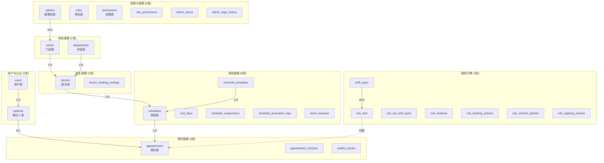

---

## 一、用户与认证

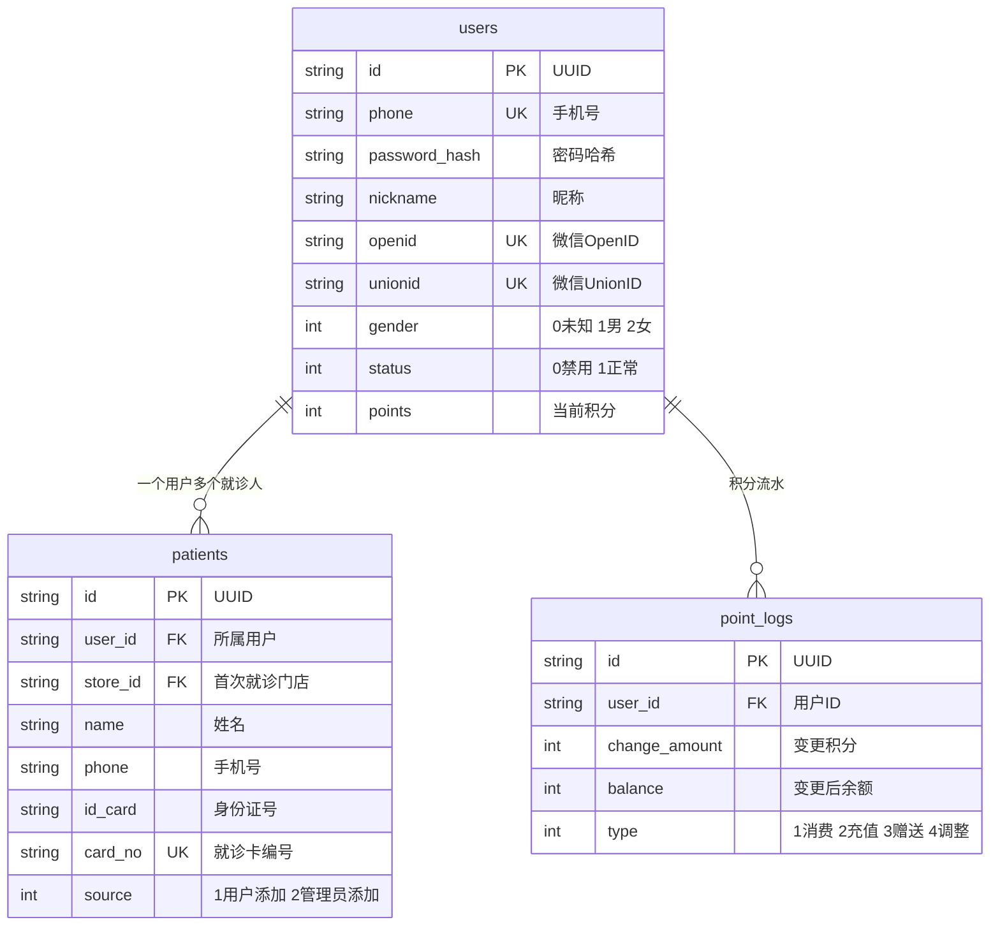

---

## 二、权限与管理

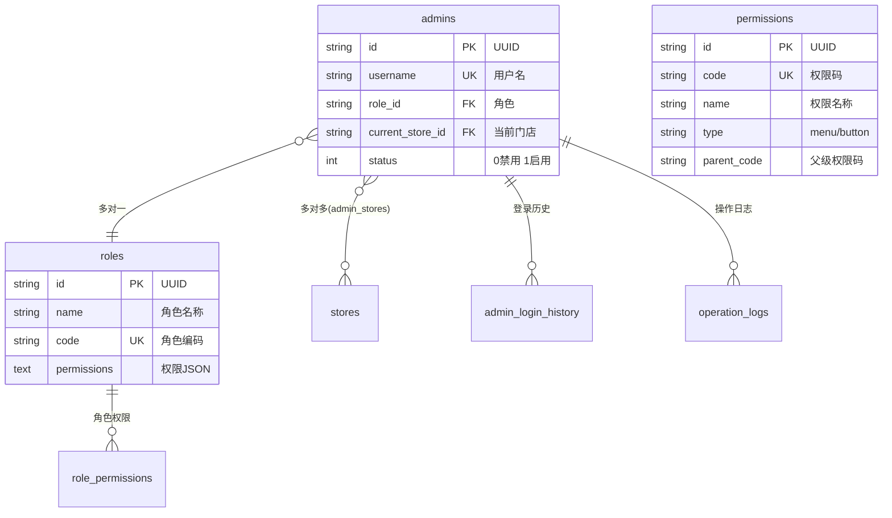

---

## 三、机构管理

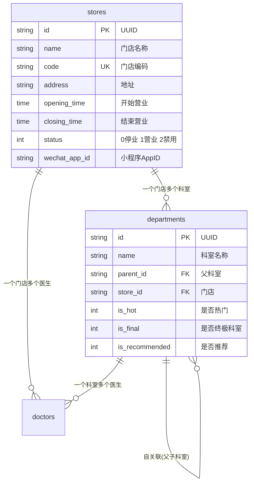

---

## 四、医生管理

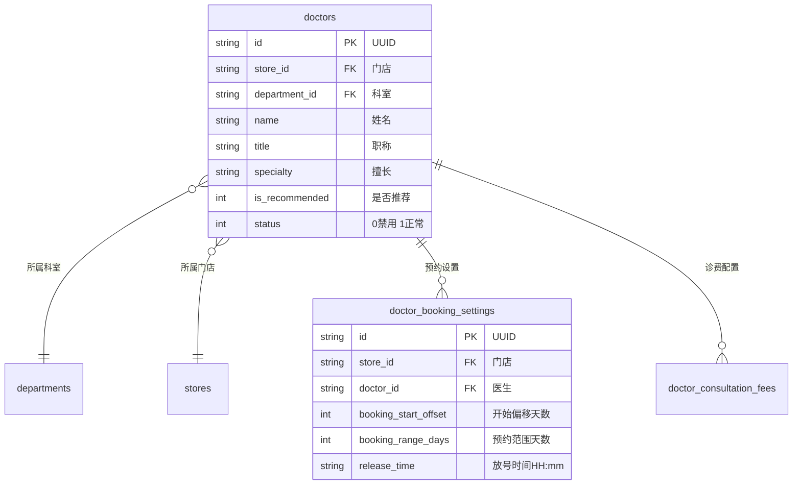

---

## 五、排班管理

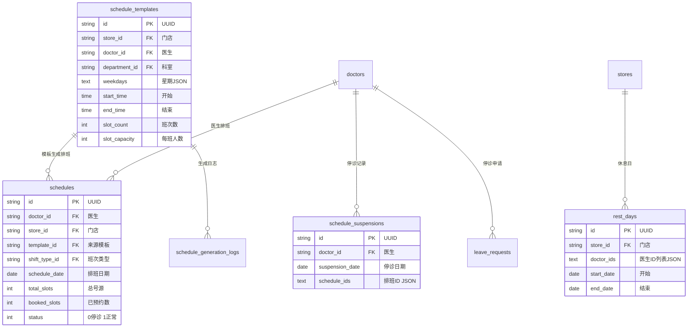

---

## 六、规则引擎

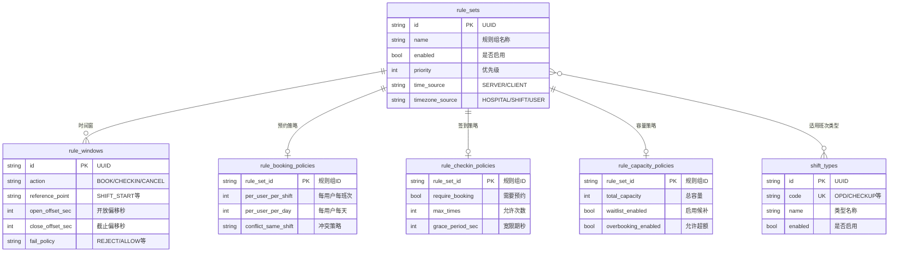

---

## 七、预约管理（核心流程）

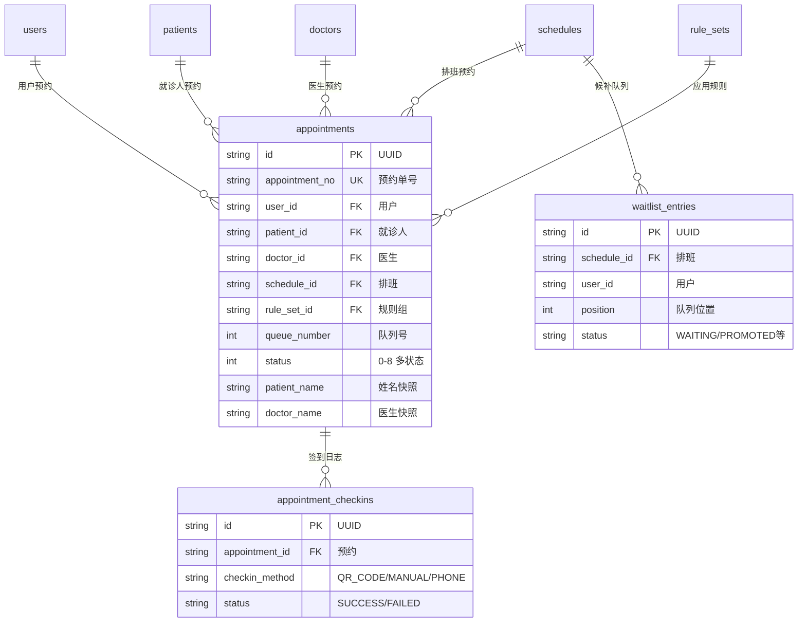

---

## 八、诊费管理（三级继承）

诊费配置遵循 **全局模板 < 门店模板 < 医生配置** 的优先级覆盖规则。

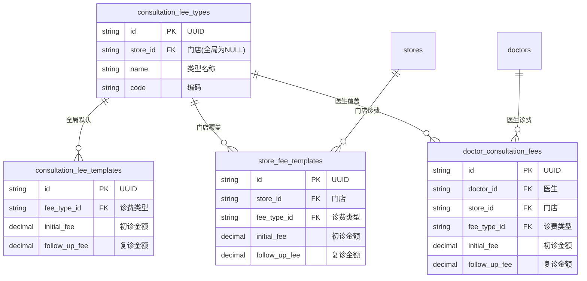

---

## 九、预约核心数据流

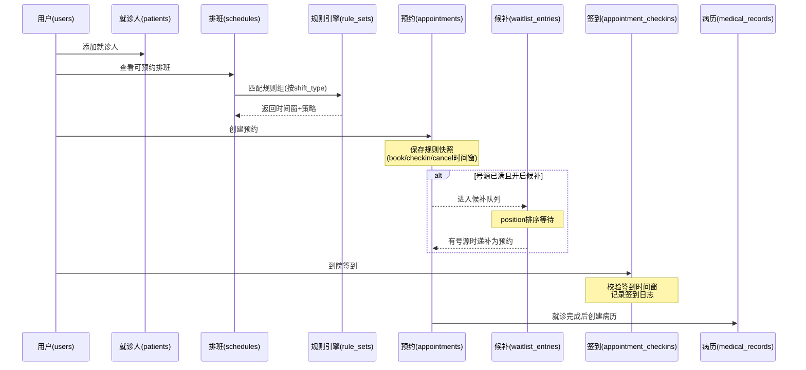

---

## 十、多租户(门店)数据隔离关系

以下表通过 `store_id` 实现门店级数据隔离：

```mermaid
graph TB
    Store["stores 门店表"]
    Store --- departments
    Store --- doctors
    Store --- schedules
    Store --- schedule_templates
    Store --- rest_days
    Store --- schedule_suspensions
    Store --- doctor_booking_settings
    Store --- system_settings
    Store --- store_visit_type_configs
    Store --- consultation_fee_types
    Store --- store_fee_templates
    Store --- doctor_consultation_fees
    Store --- news
    Store --- notices
    Store --- banners
    Store --- messages
    Store --- blacklists
    Store --- patients["patients(首次就诊门店)"]
    Store --- admin_stores["admin_stores(管理员绑定)"]
```
