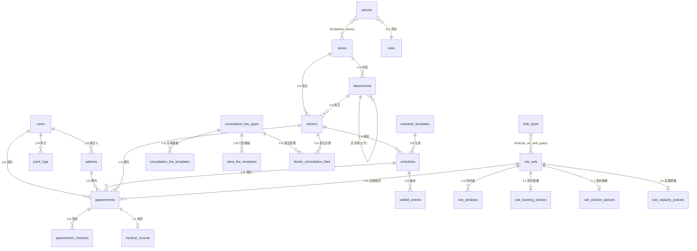

# 数据库 ER 图

> 基于 SQLAlchemy ORM 模型实际代码，最后更新：2026-02-06
> 完整字段定义见 [data-dictionary.md](./data-dictionary.md)
> 业务域详细关系见 [domain-views.md](./domain-views.md)

---

## 一、核心实体关系总览

---

## 二、表分类索引（14 域 48 表）

### 用户与认证 (2)
- `users` - 用户表
- `patients` - 就诊人表

### 权限与管理 (6)
- `admins` - 管理员表
- `roles` - 角色表
- `permissions` - 权限表
- `role_permissions` - 角色权限关联表
- `admin_stores` - 管理员门店关联表
- `admin_login_history` - 管理员登录历史

### 机构管理 (2)
- `stores` - 门店/分院表
- `departments` - 科室表

### 医生管理 (2)
- `doctors` - 医生表
- `doctor_booking_settings` - 医生预约设置

### 排班管理 (6)
- `schedule_templates` - 排班模板表
- `schedules` - 排班表
- `rest_days` - 休息日表
- `schedule_suspensions` - 停诊记录表
- `schedule_generation_logs` - 排班生成日志
- `leave_requests` - 停诊/调班申请表

### 规则引擎 (7)
- `shift_types` - 班次类型表
- `rule_sets` - 规则组表
- `rule_set_shift_types` - 规则组班次关联表
- `rule_windows` - 时间窗配置表
- `rule_booking_policies` - 预约策略表
- `rule_checkin_policies` - 签到策略表
- `rule_capacity_policies` - 容量策略表

### 预约管理 (3)
- `appointments` - 预约表
- `appointment_checkins` - 签到日志表
- `waitlist_entries` - 候补队列表

### 诊费管理 (4)
- `consultation_fee_types` - 诊费类型表
- `consultation_fee_templates` - 诊费模板表(全局)
- `store_fee_templates` - 门店诊费模板表
- `doctor_consultation_fees` - 医生诊费配置表

### 病历管理 (1)
- `medical_records` - 病历表

### 内容管理 (4)
- `news` - 新闻资讯表
- `notices` - 公告通知表
- `banners` - 轮播图表
- `booking_notices` - 预约须知表

### 消息通知 (3)
- `messages` - 消息表
- `message_templates` - 消息模板表
- `email_templates` - 邮件模板表

### 系统配置 (2)
- `system_settings` - 系统设置表
- `store_visit_type_configs` - 门店复诊规则配置

### 日志与审计 (3)
- `operation_logs` - 操作日志表
- `user_behavior_logs` - 用户行为日志表
- `point_logs` - 积分流水表

### 用户服务 (3)
- `blacklists` - 黑名单表
- `feedbacks` - 用户反馈表
- `user_favorites` - 用户收藏表

---

## 三、关系说明

### 一对一关系 (1:1)

| 主表 | 从表 | 说明 |
|------|------|------|
| appointments | medical_records | 一个预约对应一份病历 |
| rule_sets | rule_booking_policies | 一个规则组一个预约策略 |
| rule_sets | rule_checkin_policies | 一个规则组一个签到策略 |
| rule_sets | rule_capacity_policies | 一个规则组一个容量策略 |
| stores | store_visit_type_configs | 一个门店一个复诊规则 |

### 一对多关系 (1:N)

| 主表 | 从表 | 说明 |
|------|------|------|
| users | patients | 一个用户多个就诊人 |
| users | appointments | 一个用户多个预约 |
| stores | departments | 一个门店多个科室 |
| stores | doctors | 一个门店多个医生 |
| departments | departments | 父子科室(自关联) |
| departments | doctors | 一个科室多个医生 |
| doctors | schedules | 一个医生多个排班 |
| doctors | appointments | 一个医生多个预约 |
| schedules | appointments | 一个排班多个预约 |
| schedules | waitlist_entries | 一个排班多个候补 |
| schedule_templates | schedules | 一个模板生成多个排班 |
| rule_sets | rule_windows | 一个规则组多个时间窗 |
| rule_sets | appointments | 一个规则组应用于多个预约 |
| appointments | appointment_checkins | 一个预约多条签到日志 |
| roles | admins | 一个角色多个管理员 |

### 多对多关系 (M:N)

| 表A | 表B | 中间表 | 说明 |
|-----|-----|--------|------|
| admins | stores | admin_stores | 管理员门店关联 |
| roles | permissions | role_permissions | 角色权限关联 |
| rule_sets | shift_types | rule_set_shift_types | 规则组班次类型关联 |

---

## 四、设计原则

1. **主键**: 所有表使用 `VARCHAR(36)` UUID 字符串主键
2. **命名**: 表名使用复数 snake_case，字段名使用 snake_case
3. **审计**: 大多数表通过 AuditMixin 自动包含 `created_at/updated_at/created_by/updated_by`
4. **软删除**: 使用 `status` 字段标记状态，不做物理删除
5. **多租户**: 通过 `store_id` 实现门店级数据隔离
6. **快照**: 预约表包含就诊人/医生/科室快照字段，避免关联数据变更影响历史记录
7. **三级继承**: 诊费采用 全局模板 < 门店模板 < 医生配置 的优先级覆盖
