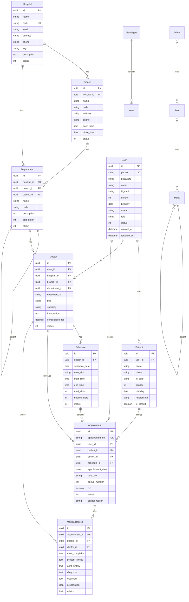

# 🗄️ 医院挂号系统 - 数据库ER图

## 一、ER图概览

### 1.1 核心实体关系图 (文本版)

```
┌─────────────────────────────────────────────────────────────────────────────────────────┐
│                                    数据库ER图                                            │
├─────────────────────────────────────────────────────────────────────────────────────────┤
│                                                                                         │
│  ┌──────────────┐                                                                       │
│  │   Hospital   │                                                                       │
│  │    医院表    │                                                                       │
│  └───────┬──────┘                                                                       │
│          │                                                                              │
│          │ 1:N                                                                          │
│          ▼                                                                              │
│  ┌──────────────┐         ┌──────────────┐         ┌──────────────┐                    │
│  │    Branch    │ ───1:N──│  Department  │ ───1:N──│    Doctor    │                    │
│  │   门店/分院  │         │    科室表    │         │    医生表    │                    │
│  └──────────────┘         └───────┬──────┘         └───────┬──────┘                    │
│                                   │                        │                           │
│                                   │ 自关联                  │                           │
│                                   │ (父子科室)              │                           │
│                                   ▼                        │                           │
│                           ┌──────────────┐                 │                           │
│                           │  Department  │                 │                           │
│                           │   (子科室)   │                 │                           │
│                           └──────────────┘                 │                           │
│                                                            │                           │
│                                                            │ 1:N                       │
│                                                            ▼                           │
│  ┌──────────────┐                                  ┌──────────────┐                    │
│  │     User     │                                  │   Schedule   │                    │
│  │    用户表    │                                  │    排班表    │                    │
│  └───────┬──────┘                                  └───────┬──────┘                    │
│          │                                                 │                           │
│          │ 1:N                                              │ 1:N                       │
│          ▼                                                 ▼                           │
│  ┌──────────────┐         ┌──────────────┐         ┌──────────────┐                    │
│  │   Patient    │ ───1:N──│ Appointment  │ ───N:1──│   Schedule   │                    │
│  │   就诊人    │         │   预约表     │         │              │                    │
│  └──────────────┘         └───────┬──────┘         └──────────────┘                    │
│                                   │                                                    │
│                                   │ 1:1                                                │
│                                   ▼                                                    │
│                           ┌──────────────┐                                             │
│                           │MedicalRecord │                                             │
│                           │   病历表     │                                             │
│                           └──────────────┘                                             │
│                                                                                         │
│  ══════════════════════════════════════════════════════════════════════════════════    │
│                                                                                         │
│  【权限相关】                                                                           │
│                                                                                         │
│  ┌──────────────┐         ┌──────────────┐         ┌──────────────┐                    │
│  │    Admin     │ ───N:M──│     Role     │ ───N:M──│    Menu      │                    │
│  │   管理员    │         │    角色表    │         │   菜单表     │                    │
│  └──────────────┘         └──────────────┘         └───────┬──────┘                    │
│                                                            │                           │
│                                                            │ 自关联                    │
│                                                            ▼                           │
│                                                    ┌──────────────┐                    │
│                                                    │    Menu      │                    │
│                                                    │  (子菜单)    │                    │
│                                                    └──────────────┘                    │
│                                                                                         │
│  【内容相关】                                                                           │
│                                                                                         │
│  ┌──────────────┐         ┌──────────────┐                                             │
│  │  NewsType    │ ───1:N──│    News      │                                             │
│  │  新闻分类    │         │   新闻表     │                                             │
│  └──────────────┘         └──────────────┘                                             │
│                                                                                         │
│  ┌──────────────┐    ┌──────────────┐    ┌──────────────┐                              │
│  │   Banner     │    │    Popup     │    │   Notice     │                              │
│  │   轮播图    │    │   弹框表     │    │   公告表     │                              │
│  └──────────────┘    └──────────────┘    └──────────────┘                              │
│                                                                                         │
│  【系统相关】                                                                           │
│                                                                                         │
│  ┌──────────────┐    ┌──────────────┐    ┌──────────────┐                              │
│  │   Setting    │    │OperationLog │    │  Feedback    │                              │
│  │   系统设置   │    │  操作日志    │    │  用户反馈    │                              │
│  └──────────────┘    └──────────────┘    └──────────────┘                              │
│                                                                                         │
└─────────────────────────────────────────────────────────────────────────────────────────┘
```

### 1.2 Mermaid ER图代码



---

## 二、实体详细设计

### 2.1 核心业务实体

#### 用户相关

| 实体 | 说明 | 主要属性 |
|------|------|---------|
| User | 用户表（所有角色） | id, phone, password, name, role |
| Admin | 管理员表 | id, user_id, department_id |
| Patient | 就诊人表 | id, user_id, name, id_card, relationship |
| Blacklist | 黑名单表 | id, user_id, reason, expire_at |

#### 机构相关

| 实体 | 说明 | 主要属性 |
|------|------|---------|
| Hospital | 医院表 | id, name, code, level, address |
| Branch | 门店/分院表 | id, hospital_id, name, address |
| Department | 科室表 | id, branch_id, parent_id, name |
| Doctor | 医生表 | id, user_id, department_id, title |

#### 预约相关

| 实体 | 说明 | 主要属性 |
|------|------|---------|
| Schedule | 排班表 | id, doctor_id, date, time_slot, total_slots |
| ScheduleTemplate | 排班模板表 | id, doctor_id, weekday, time_slot |
| Appointment | 预约表 | id, user_id, doctor_id, schedule_id, status |
| MedicalRecord | 病历表 | id, appointment_id, diagnosis, prescription |

#### 内容相关

| 实体 | 说明 | 主要属性 |
|------|------|---------|
| NewsType | 新闻分类表 | id, name, sort_order |
| News | 新闻表 | id, type_id, title, content |
| Banner | 轮播图表 | id, title, image_url, link_url |
| Notice | 公告表 | id, title, content, type |
| Popup | 弹框表 | id, title, image_url, link_url |

#### 系统相关

| 实体 | 说明 | 主要属性 |
|------|------|---------|
| Role | 角色表 | id, name, code, description |
| Menu | 菜单表 | id, parent_id, name, path, permission |
| RoleMenu | 角色菜单关联表 | role_id, menu_id |
| Setting | 系统设置表 | id, key, value, group |
| OperationLog | 操作日志表 | id, admin_id, action, content |
| Feedback | 用户反馈表 | id, user_id, content, status |
| Notification | 通知表 | id, user_id, title, content, is_read |

---

## 三、关系说明

### 3.1 一对一关系 (1:1)

| 主表 | 从表 | 说明 |
|------|------|------|
| User | Doctor | 一个用户对应一个医生信息 |
| Appointment | MedicalRecord | 一个预约对应一份病历 |

### 3.2 一对多关系 (1:N)

| 主表 | 从表 | 说明 |
|------|------|------|
| Hospital | Branch | 一个医院有多个分院 |
| Hospital | Department | 一个医院有多个科室 |
| Branch | Department | 一个分院有多个科室 |
| Department | Department | 一个科室有多个子科室 |
| Department | Doctor | 一个科室有多个医生 |
| User | Patient | 一个用户有多个就诊人 |
| User | Appointment | 一个用户有多个预约 |
| Doctor | Schedule | 一个医生有多个排班 |
| Doctor | Appointment | 一个医生有多个预约 |
| Schedule | Appointment | 一个排班有多个预约 |
| NewsType | News | 一个分类有多个新闻 |
| Menu | Menu | 一个菜单有多个子菜单 |

### 3.3 多对多关系 (N:M)

| 表A | 表B | 中间表 | 说明 |
|-----|-----|--------|------|
| Admin | Role | admin_role | 管理员角色关联 |
| Role | Menu | role_menu | 角色菜单权限关联 |

---

## 四、索引设计

### 4.1 主键索引

所有表使用 UUID 作为主键，自动创建主键索引。

### 4.2 唯一索引

| 表 | 字段 | 说明 |
|-----|------|------|
| users | phone | 手机号唯一 |
| hospitals | code | 医院编码唯一 |
| appointments | appointment_no | 预约单号唯一 |
| schedules | (doctor_id, schedule_date, time_slot) | 医生日期时段唯一 |
| settings | key | 设置键唯一 |

### 4.3 普通索引

| 表 | 字段 | 说明 |
|-----|------|------|
| users | role | 按角色查询 |
| users | status | 按状态查询 |
| doctors | department_id | 按科室查询 |
| doctors | branch_id | 按门店查询 |
| schedules | doctor_id | 按医生查询 |
| schedules | schedule_date | 按日期查询 |
| appointments | user_id | 按用户查询 |
| appointments | doctor_id | 按医生查询 |
| appointments | appointment_date | 按日期查询 |
| appointments | status | 按状态查询 |
| medical_records | patient_id | 按患者查询 |

---

## 五、PlantUML ER图代码

```plantuml
@startuml

entity "users" as users {
  * id : uuid <<PK>>
  --
  * phone : varchar(20) <<UK>>
  * password : varchar(255)
  * name : varchar(50)
  id_card : varchar(18)
  gender : smallint
  birthday : date
  avatar : varchar(500)
  * role : varchar(20)
  status : smallint
  created_at : timestamp
  updated_at : timestamp
}

entity "hospitals" as hospitals {
  * id : uuid <<PK>>
  --
  * name : varchar(100)
  * code : varchar(50) <<UK>>
  level : varchar(20)
  address : varchar(500)
  phone : varchar(20)
  logo : varchar(500)
  description : text
  status : smallint
}

entity "branches" as branches {
  * id : uuid <<PK>>
  --
  * hospital_id : uuid <<FK>>
  * name : varchar(100)
  code : varchar(50)
  address : varchar(500)
  phone : varchar(20)
  open_time : time
  close_time : time
  status : smallint
}

entity "departments" as departments {
  * id : uuid <<PK>>
  --
  * hospital_id : uuid <<FK>>
  branch_id : uuid <<FK>>
  parent_id : uuid <<FK>>
  * name : varchar(100)
  code : varchar(50)
  description : text
  sort_order : int
  status : smallint
}

entity "doctors" as doctors {
  * id : uuid <<PK>>
  --
  * user_id : uuid <<FK>>
  * hospital_id : uuid <<FK>>
  branch_id : uuid <<FK>>
  * department_id : uuid <<FK>>
  employee_no : varchar(50)
  title : varchar(50)
  specialty : varchar(500)
  introduction : text
  consultation_fee : decimal(10,2)
  status : smallint
}

entity "patients" as patients {
  * id : uuid <<PK>>
  --
  * user_id : uuid <<FK>>
  * name : varchar(50)
  * phone : varchar(20)
  id_card : varchar(18)
  gender : smallint
  birthday : date
  relationship : varchar(20)
  is_default : boolean
}

entity "schedules" as schedules {
  * id : uuid <<PK>>
  --
  * doctor_id : uuid <<FK>>
  * schedule_date : date
  * time_slot : varchar(20)
  * start_time : time
  * end_time : time
  * total_slots : int
  booked_slots : int
  status : smallint
}

entity "appointments" as appointments {
  * id : uuid <<PK>>
  --
  * appointment_no : varchar(50) <<UK>>
  * user_id : uuid <<FK>>
  * patient_id : uuid <<FK>>
  * doctor_id : uuid <<FK>>
  * schedule_id : uuid <<FK>>
  * appointment_date : date
  * time_slot : varchar(20)
  queue_number : int
  fee : decimal(10,2)
  status : smallint
  cancel_reason : varchar(500)
}

entity "medical_records" as medical_records {
  * id : uuid <<PK>>
  --
  * appointment_id : uuid <<FK>>
  * patient_id : uuid <<FK>>
  * doctor_id : uuid <<FK>>
  chief_complaint : text
  present_illness : text
  past_history : text
  diagnosis : text
  treatment : text
  prescription : jsonb
  advice : text
  visit_date : timestamp
}

hospitals ||--o{ branches
hospitals ||--o{ departments
branches ||--o{ departments
departments ||--o{ departments : parent
departments ||--o{ doctors

users ||--o| doctors
users ||--o{ patients
users ||--o{ appointments

doctors ||--o{ schedules
doctors ||--o{ appointments
doctors ||--o{ medical_records

schedules ||--o{ appointments

patients ||--o{ appointments
appointments ||--o| medical_records

@enduml
```



---

## 六、数据库设计原则

### 6.1 设计原则

1. **主键设计**：使用 UUID 作为主键，避免分布式环境下的ID冲突
2. **字段命名**：使用下划线命名法（snake_case）
3. **时间字段**：所有表包含 created_at 和 updated_at 字段
4. **软删除**：使用 status 字段标记删除状态，而非物理删除
5. **外键约束**：使用外键保证数据完整性
6. **索引优化**：根据查询频率添加必要索引

### 6.2 数据类型规范

| 类型 | 使用场景 | 说明 |
|------|---------|------|
| UUID | 主键、外键 | 全局唯一标识 |
| VARCHAR(N) | 短文本 | 根据实际长度设置 |
| TEXT | 长文本 | 描述、内容等 |
| SMALLINT | 状态、枚举 | 0-32767 |
| INT | 数量、序号 | 整数 |
| DECIMAL(10,2) | 金额 | 精确小数 |
| DATE | 日期 | 年月日 |
| TIME | 时间 | 时分秒 |
| TIMESTAMP | 时间戳 | 日期+时间 |
| BOOLEAN | 布尔值 | true/false |
| JSONB | JSON数据 | 结构化数据 |

