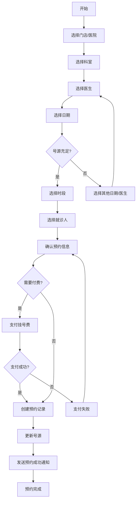
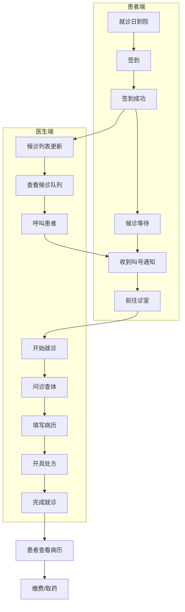
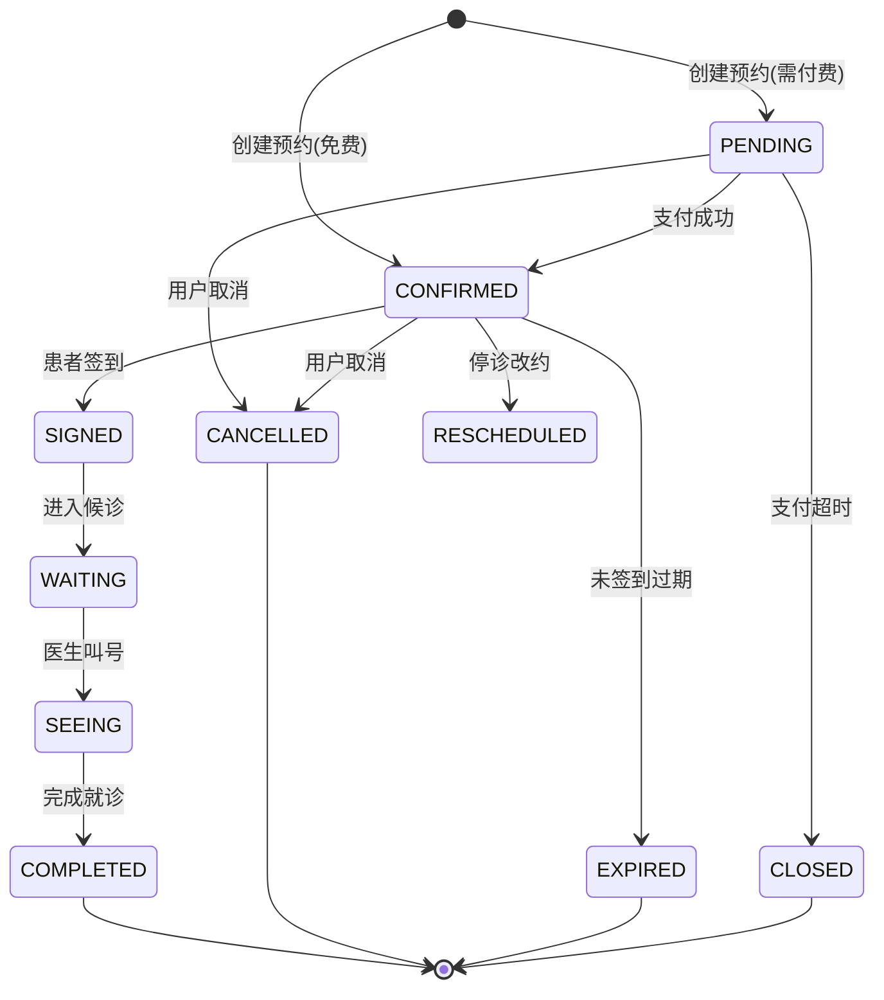

# 📊 医院挂号系统 - 系统流程图

## 一、核心业务流程

### 1.1 用户注册登录流程

```
┌─────────────────────────────────────────────────────────────────────────┐
│                         用户注册登录流程                                 │
├─────────────────────────────────────────────────────────────────────────┤
│                                                                         │
│  【注册流程】                                                            │
│                                                                         │
│  ┌─────────┐   ┌─────────┐   ┌─────────┐   ┌─────────┐   ┌─────────┐  │
│  │输入手机号│──>│发送验证码│──>│输入验证码│──>│设置密码 │──>│完善信息 │  │
│  └─────────┘   └─────────┘   └─────────┘   └─────────┘   └─────────┘  │
│                                                                  │      │
│                                                                  ▼      │
│                                                           ┌─────────┐  │
│                                                           │注册成功 │  │
│                                                           └─────────┘  │
│                                                                         │
│  ═══════════════════════════════════════════════════════════════════   │
│                                                                         │
│  【登录流程】                                                            │
│                                                                         │
│       ┌──────────────────────────────────────┐                         │
│       │              登录方式选择             │                         │
│       └─────────────────┬────────────────────┘                         │
│                         │                                               │
│         ┌───────────────┼───────────────┐                              │
│         │               │               │                              │
│         ▼               ▼               ▼                              │
│  ┌─────────────┐ ┌─────────────┐ ┌─────────────┐                       │
│  │ 手机号+密码 │ │ 验证码登录  │ │ 微信授权    │                       │
│  └──────┬──────┘ └──────┬──────┘ └──────┬──────┘                       │
│         │               │               │                              │
│         └───────────────┼───────────────┘                              │
│                         │                                               │
│                         ▼                                               │
│                  ┌─────────────┐                                        │
│                  │  验证凭证   │                                        │
│                  └──────┬──────┘                                        │
│                         │                                               │
│            ┌────────────┴────────────┐                                 │
│            │                         │                                 │
│            ▼                         ▼                                 │
│     ┌─────────────┐          ┌─────────────┐                           │
│     │  验证成功   │          │  验证失败   │                           │
│     └──────┬──────┘          └──────┬──────┘                           │
│            │                        │                                  │
│            ▼                        ▼                                  │
│     ┌─────────────┐          ┌─────────────┐                           │
│     │生成JWT Token│          │ 返回错误   │                           │
│     │  登录成功   │          │  重新登录   │                           │
│     └─────────────┘          └─────────────┘                           │
│                                                                         │
└─────────────────────────────────────────────────────────────────────────┘
```

### 1.2 预约挂号完整流程

```
┌─────────────────────────────────────────────────────────────────────────┐
│                         预约挂号完整流程                                 │
├─────────────────────────────────────────────────────────────────────────┤
│                                                                         │
│  ┌─────────┐                                                           │
│  │  开始   │                                                           │
│  └────┬────┘                                                           │
│       │                                                                │
│       ▼                                                                │
│  ┌─────────────┐     ┌─────────────┐                                   │
│  │ 选择门店/   │────>│ 选择科室    │                                   │
│  │  医院       │     │             │                                   │
│  └─────────────┘     └──────┬──────┘                                   │
│                              │                                          │
│                              ▼                                          │
│                       ┌─────────────┐                                   │
│                       │ 选择医生    │                                   │
│                       │ (查看简介)  │                                   │
│                       └──────┬──────┘                                   │
│                              │                                          │
│                              ▼                                          │
│                       ┌─────────────┐                                   │
│                       │ 选择日期    │                                   │
│                       │(查看号源)   │                                   │
│                       └──────┬──────┘                                   │
│                              │                                          │
│                              ▼                                          │
│                       ┌─────────────┐     ┌─────────────┐               │
│                       │ 号源是否    │──否─>│ 选择其他    │               │
│                       │   充足？    │     │ 日期/医生   │               │
│                       └──────┬──────┘     └─────────────┘               │
│                              │是                                        │
│                              ▼                                          │
│                       ┌─────────────┐                                   │
│                       │选择时段     │                                   │
│                       │(上午/下午)  │                                   │
│                       └──────┬──────┘                                   │
│                              │                                          │
│                              ▼                                          │
│                       ┌─────────────┐     ┌─────────────┐               │
│                       │ 选择就诊人  │────>│ 新增就诊人  │               │
│                       │             │     │ (如需要)    │               │
│                       └──────┬──────┘     └─────────────┘               │
│                              │                                          │
│                              ▼                                          │
│                       ┌─────────────┐                                   │
│                       │ 确认预约    │                                   │
│                       │   信息      │                                   │
│                       └──────┬──────┘                                   │
│                              │                                          │
│                              ▼                                          │
│                       ┌─────────────┐                                   │
│                       │ 是否需要    │                                   │
│                       │  付费？     │                                   │
│                       └──────┬──────┘                                   │
│                              │                                          │
│            ┌─────────────────┴─────────────────┐                       │
│            │是                                 │否                      │
│            ▼                                   ▼                       │
│     ┌─────────────┐                     ┌─────────────┐                │
│     │  支付挂号费 │                     │  直接预约   │                │
│     └──────┬──────┘                     └──────┬──────┘                │
│            │                                   │                       │
│            ▼                                   │                       │
│     ┌─────────────┐                            │                       │
│     │ 支付成功？  │                            │                       │
│     └──────┬──────┘                            │                       │
│            │是                                 │                       │
│            └───────────────┬───────────────────┘                       │
│                            │                                           │
│                            ▼                                           │
│                     ┌─────────────┐                                    │
│                     │  创建预约   │                                    │
│                     │  记录       │                                    │
│                     └──────┬──────┘                                    │
│                            │                                           │
│                            ▼                                           │
│                     ┌─────────────┐                                    │
│                     │  更新号源   │                                    │
│                     │ (已约+1)    │                                    │
│                     └──────┬──────┘                                    │
│                            │                                           │
│                            ▼                                           │
│                     ┌─────────────┐                                    │
│                     │ 发送预约    │                                    │
│                     │ 成功通知    │                                    │
│                     └──────┬──────┘                                    │
│                            │                                           │
│                            ▼                                           │
│                     ┌─────────────┐                                    │
│                     │  预约完成   │                                    │
│                     └─────────────┘                                    │
│                                                                         │
└─────────────────────────────────────────────────────────────────────────┘
```

### 1.3 就诊流程

```
┌─────────────────────────────────────────────────────────────────────────┐
│                            就诊流程                                      │
├─────────────────────────────────────────────────────────────────────────┤
│                                                                         │
│  【患者端】                          【医生端】                          │
│                                                                         │
│  ┌─────────────┐                                                        │
│  │  就诊日     │                                                        │
│  │  患者到院   │                                                        │
│  └──────┬──────┘                                                        │
│         │                                                               │
│         ▼                                                               │
│  ┌─────────────┐                                                        │
│  │   签到      │                                                        │
│  │(扫码/自助机)│                                                        │
│  └──────┬──────┘                                                        │
│         │                                                               │
│         ▼                                                               │
│  ┌─────────────┐                    ┌─────────────┐                     │
│  │ 签到成功    │ ──────────────────>│ 候诊列表    │                     │
│  │ 进入候诊    │                    │   更新      │                     │
│  └──────┬──────┘                    └──────┬──────┘                     │
│         │                                   │                           │
│         ▼                                   ▼                           │
│  ┌─────────────┐                    ┌─────────────┐                     │
│  │  候诊等待   │                    │ 查看候诊    │                     │
│  │ (查看排队)  │                    │   队列      │                     │
│  └──────┬──────┘                    └──────┬──────┘                     │
│         │                                   │                           │
│         │                                   ▼                           │
│         │                           ┌─────────────┐                     │
│         │                           │  呼叫患者   │                     │
│         │                           │ (叫号)      │                     │
│         │                           └──────┬──────┘                     │
│         │                                   │                           │
│         ▼                                   │                           │
│  ┌─────────────┐                            │                           │
│  │ 收到叫号    │<───────────────────────────┘                           │
│  │   通知      │                                                        │
│  └──────┬──────┘                                                        │
│         │                                                               │
│         ▼                                                               │
│  ┌─────────────┐                    ┌─────────────┐                     │
│  │ 前往诊室    │ ──────────────────>│ 开始就诊    │                     │
│  │   就诊      │                    │             │                     │
│  └─────────────┘                    └──────┬──────┘                     │
│                                            │                           │
│                                            ▼                           │
│                                     ┌─────────────┐                     │
│                                     │  问诊查体   │                     │
│                                     └──────┬──────┘                     │
│                                            │                           │
│                                            ▼                           │
│                                     ┌─────────────┐                     │
│                                     │  填写病历   │                     │
│                                     │ (主诉/诊断) │                     │
│                                     └──────┬──────┘                     │
│                                            │                           │
│                                            ▼                           │
│                                     ┌─────────────┐                     │
│                                     │  开具处方   │                     │
│                                     │  /检查单    │                     │
│                                     └──────┬──────┘                     │
│                                            │                           │
│                                            ▼                           │
│                                     ┌─────────────┐                     │
│                                     │ 完成就诊    │                     │
│                                     └──────┬──────┘                     │
│                                            │                           │
│         ┌──────────────────────────────────┘                           │
│         │                                                               │
│         ▼                                                               │
│  ┌─────────────┐                                                        │
│  │ 查看病历    │                                                        │
│  │ /处方信息   │                                                        │
│  └──────┬──────┘                                                        │
│         │                                                               │
│         ▼                                                               │
│  ┌─────────────┐                                                        │
│  │缴费/取药    │                                                        │
│  │  /检查      │                                                        │
│  └─────────────┘                                                        │
│                                                                         │
└─────────────────────────────────────────────────────────────────────────┘
```

### 1.4 排班管理流程

```
┌─────────────────────────────────────────────────────────────────────────┐
│                          排班管理流程                                    │
├─────────────────────────────────────────────────────────────────────────┤
│                                                                         │
│  ┌─────────────────────────────────────────────────────────────────┐   │
│  │                      排班模板创建                                │   │
│  └─────────────────────────────────────────────────────────────────┘   │
│                                                                         │
│  ┌─────────────┐     ┌─────────────┐     ┌─────────────┐               │
│  │ 选择科室    │────>│ 选择医生    │────>│ 设置排班    │               │
│  │             │     │             │     │   周期      │               │
│  └─────────────┘     └─────────────┘     └──────┬──────┘               │
│                                                  │                      │
│                                                  ▼                      │
│                                           ┌─────────────┐               │
│                                           │ 配置时段    │               │
│                                           │ (上午/下午) │               │
│                                           └──────┬──────┘               │
│                                                  │                      │
│                                                  ▼                      │
│                                           ┌─────────────┐               │
│                                           │ 设置号源数  │               │
│                                           │             │               │
│                                           └──────┬──────┘               │
│                                                  │                      │
│                                                  ▼                      │
│                                           ┌─────────────┐               │
│                                           │ 保存模板    │               │
│                                           └─────────────┘               │
│                                                                         │
│  ═══════════════════════════════════════════════════════════════════   │
│                                                                         │
│  ┌─────────────────────────────────────────────────────────────────┐   │
│  │                      排班生成流程                                │   │
│  └─────────────────────────────────────────────────────────────────┘   │
│                                                                         │
│  ┌─────────────┐     ┌─────────────┐     ┌─────────────┐               │
│  │ 获取排班    │────>│ 检查休息日  │────>│ 检查特殊    │               │
│  │   模板      │     │   配置      │     │  日期配置   │               │
│  └─────────────┘     └─────────────┘     └──────┬──────┘               │
│                                                  │                      │
│                                                  ▼                      │
│                                           ┌─────────────┐               │
│                                           │ 生成排班    │               │
│                                           │   计划      │               │
│                                           └──────┬──────┘               │
│                                                  │                      │
│                                                  ▼                      │
│                                           ┌─────────────┐               │
│                                           │ 管理员审核  │               │
│                                           └──────┬──────┘               │
│                                                  │                      │
│                            ┌─────────────────────┴─────────────────┐   │
│                            │                                       │   │
│                            ▼                                       ▼   │
│                     ┌─────────────┐                         ┌─────────┐│
│                     │  审核通过   │                         │审核拒绝 ││
│                     └──────┬──────┘                         │修改后   ││
│                            │                                │重新提交 ││
│                            ▼                                └─────────┘│
│                     ┌─────────────┐                                    │
│                     │ 号源生效    │                                    │
│                     │(可预约)     │                                    │
│                     └─────────────┘                                    │
│                                                                         │
└─────────────────────────────────────────────────────────────────────────┘
```

### 1.5 停诊处理流程

```
┌─────────────────────────────────────────────────────────────────────────┐
│                          停诊处理流程                                    │
├─────────────────────────────────────────────────────────────────────────┤
│                                                                         │
│  【医生端】                【机构后台】              【患者端】           │
│                                                                         │
│  ┌─────────────┐                                                        │
│  │  申请停诊   │                                                        │
│  │(选择日期/   │                                                        │
│  │ 时段/原因)  │                                                        │
│  └──────┬──────┘                                                        │
│         │                                                               │
│         │               ┌─────────────┐                                 │
│         └──────────────>│ 停诊审核    │                                 │
│                         └──────┬──────┘                                 │
│                                │                                        │
│               ┌────────────────┴────────────────┐                      │
│               │                                 │                      │
│               ▼                                 ▼                      │
│        ┌─────────────┐                   ┌─────────────┐               │
│        │  审核通过   │                   │  审核拒绝   │               │
│        └──────┬──────┘                   └──────┬──────┘               │
│               │                                 │                      │
│               │                                 ▼                      │
│               │                          ┌─────────────┐               │
│               │                          │ 通知医生    │               │
│               │                          │ 拒绝原因    │               │
│               │                          └─────────────┘               │
│               │                                                        │
│               ▼                                                        │
│        ┌─────────────┐                                                 │
│        │ 更新排班    │                                                 │
│        │ 状态为停诊  │                                                 │
│        └──────┬──────┘                                                 │
│               │                                                        │
│               ▼                                                        │
│        ┌─────────────┐                                                 │
│        │ 查询已预约  │                                                 │
│        │   患者      │                                                 │
│        └──────┬──────┘                                                 │
│               │                                                        │
│               ▼                                                        │
│        ┌─────────────┐                   ┌─────────────┐               │
│        │ 发送停诊    │──────────────────>│ 收到停诊    │               │
│        │   通知      │                   │   通知      │               │
│        └──────┬──────┘                   └──────┬──────┘               │
│               │                                 │                      │
│               │                                 ▼                      │
│               │                          ┌─────────────┐               │
│               │                          │  选择处理   │               │
│               │                          │   方式      │               │
│               │                          └──────┬──────┘               │
│               │                                 │                      │
│               │                    ┌────────────┴────────────┐        │
│               │                    │                         │        │
│               │                    ▼                         ▼        │
│               │             ┌─────────────┐          ┌─────────────┐  │
│               │             │  申请退款   │          │  重新预约   │  │
│               │             └──────┬──────┘          └─────────────┘  │
│               │                    │                                  │
│               ▼                    │                                  │
│        ┌─────────────┐             │                                  │
│        │  处理退款   │<────────────┘                                  │
│        └──────┬──────┘                                                │
│               │                                                        │
│               ▼                                                        │
│        ┌─────────────┐                   ┌─────────────┐               │
│        │ 退款到账    │──────────────────>│ 收到退款    │               │
│        └─────────────┘                   └─────────────┘               │
│                                                                         │
└─────────────────────────────────────────────────────────────────────────┘
```

### 1.6 取消预约流程

```
┌─────────────────────────────────────────────────────────────────────────┐
│                          取消预约流程                                    │
├─────────────────────────────────────────────────────────────────────────┤
│                                                                         │
│  ┌─────────────┐                                                        │
│  │ 患者发起    │                                                        │
│  │ 取消预约    │                                                        │
│  └──────┬──────┘                                                        │
│         │                                                               │
│         ▼                                                               │
│  ┌─────────────┐                                                        │
│  │ 检查预约    │                                                        │
│  │   状态      │                                                        │
│  └──────┬──────┘                                                        │
│         │                                                               │
│         ▼                                                               │
│  ┌─────────────┐     ┌─────────────┐                                   │
│  │ 是否可取消? │──否─>│ 提示不可    │                                   │
│  │(检查时间)   │     │  取消原因   │                                   │
│  └──────┬──────┘     └─────────────┘                                   │
│         │是                                                             │
│         ▼                                                               │
│  ┌─────────────┐                                                        │
│  │ 确认取消    │                                                        │
│  │(选择原因)   │                                                        │
│  └──────┬──────┘                                                        │
│         │                                                               │
│         ▼                                                               │
│  ┌─────────────┐                                                        │
│  │ 是否需要    │                                                        │
│  │   退款？    │                                                        │
│  └──────┬──────┘                                                        │
│         │                                                               │
│    ┌────┴────┐                                                         │
│    │         │                                                         │
│    ▼         ▼                                                         │
│ ┌──────┐  ┌──────┐                                                     │
│ │ 需要 │  │不需要│                                                     │
│ └──┬───┘  └──┬───┘                                                     │
│    │         │                                                         │
│    ▼         │                                                         │
│ ┌──────────┐ │                                                         │
│ │ 计算退款 │ │                                                         │
│ │   金额   │ │                                                         │
│ └────┬─────┘ │                                                         │
│      │       │                                                         │
│      ▼       │                                                         │
│ ┌──────────┐ │                                                         │
│ │ 发起退款 │ │                                                         │
│ └────┬─────┘ │                                                         │
│      │       │                                                         │
│      └───────┴────────┐                                                │
│                       │                                                │
│                       ▼                                                │
│                ┌─────────────┐                                         │
│                │ 更新预约    │                                         │
│                │ 状态为取消  │                                         │
│                └──────┬──────┘                                         │
│                       │                                                │
│                       ▼                                                │
│                ┌─────────────┐                                         │
│                │ 释放号源    │                                         │
│                │ (已约-1)    │                                         │
│                └──────┬──────┘                                         │
│                       │                                                │
│                       ▼                                                │
│                ┌─────────────┐                                         │
│                │ 取消完成    │                                         │
│                └─────────────┘                                         │
│                                                                         │
└─────────────────────────────────────────────────────────────────────────┘
```

---

## 二、状态流转图

### 2.1 预约状态流转

```
┌─────────────────────────────────────────────────────────────────────────┐
│                         预约状态流转图                                   │
├─────────────────────────────────────────────────────────────────────────┤
│                                                                         │
│                         ┌─────────────┐                                 │
│                         │   PENDING   │                                 │
│                         │   待支付    │ ◄──────── 创建预约(需付费)       │
│                         └──────┬──────┘                                 │
│                                │                                        │
│           ┌────────────────────┼────────────────────┐                  │
│           │                    │                    │                  │
│           ▼                    ▼                    ▼                  │
│    ┌─────────────┐     ┌─────────────┐      ┌─────────────┐            │
│    │ CONFIRMED   │     │   CLOSED    │      │ CANCELLED   │            │
│    │  已预约     │     │   已关闭    │      │  已取消     │            │
│    └──────┬──────┘     │ (支付超时)  │      │ (用户取消)  │            │
│           │            └─────────────┘      └─────────────┘            │
│           │                                                            │
│           │◄─────────────────────────────── 创建预约(免费)             │
│           │                                                            │
│    ┌──────┼──────────────────┬─────────────────────┐                  │
│    │      │                  │                     │                  │
│    ▼      ▼                  ▼                     ▼                  │
│ ┌──────┐ ┌──────┐     ┌─────────────┐       ┌─────────────┐           │
│ │SIGNED│ │CANCEL│     │  EXPIRED    │       │ RESCHEDULED │           │
│ │已签到│ │已取消│     │   已过期    │       │  已改约     │           │
│ └──┬───┘ └──────┘     │(未签到过期) │       │  (停诊)     │           │
│    │                  └─────────────┘       └─────────────┘           │
│    │                                                                   │
│    ▼                                                                   │
│ ┌─────────────┐                                                        │
│ │  WAITING    │                                                        │
│ │  候诊中     │                                                        │
│ └──────┬──────┘                                                        │
│        │                                                               │
│        ▼                                                               │
│ ┌─────────────┐     ┌─────────────┐                                   │
│ │   SEEING    │────>│ COMPLETED   │                                   │
│ │  就诊中     │     │   已完成    │                                   │
│ └─────────────┘     └─────────────┘                                   │
│                                                                         │
│  ═══════════════════════════════════════════════════════════════════   │
│                                                                         │
│  状态码对照：                                                           │
│  ┌────────┬───────────┬────────────────────────────────┐               │
│  │ 状态码 │   状态    │           说明                 │               │
│  ├────────┼───────────┼────────────────────────────────┤               │
│  │   0    │ PENDING   │ 待支付（需付费预约）           │               │
│  │   1    │ CONFIRMED │ 已预约/待就诊                  │               │
│  │   2    │ SIGNED    │ 已签到                         │               │
│  │   3    │ WAITING   │ 候诊中                         │               │
│  │   4    │ SEEING    │ 就诊中                         │               │
│  │   5    │ COMPLETED │ 已完成                         │               │
│  │   6    │ CANCELLED │ 已取消                         │               │
│  │   7    │ EXPIRED   │ 已过期                         │               │
│  │   8    │ CLOSED    │ 已关闭（支付超时）             │               │
│  │   9    │RESCHEDULED│ 已改约（停诊转移）             │               │
│  └────────┴───────────┴────────────────────────────────┘               │
│                                                                         │
└─────────────────────────────────────────────────────────────────────────┘
```

### 2.2 排班状态流转

```
┌─────────────────────────────────────────────────────────────────────────┐
│                         排班状态流转图                                   │
├─────────────────────────────────────────────────────────────────────────┤
│                                                                         │
│                    ┌─────────────┐                                      │
│                    │   DRAFT     │                                      │
│                    │   草稿      │ ◄──────── 创建排班                   │
│                    └──────┬──────┘                                      │
│                           │                                             │
│                           ▼                                             │
│                    ┌─────────────┐                                      │
│                    │  PENDING    │                                      │
│                    │  待审核     │                                      │
│                    └──────┬──────┘                                      │
│                           │                                             │
│              ┌────────────┴────────────┐                               │
│              │                         │                               │
│              ▼                         ▼                               │
│       ┌─────────────┐          ┌─────────────┐                         │
│       │  APPROVED   │          │  REJECTED   │                         │
│       │  审核通过   │          │  审核拒绝   │                         │
│       └──────┬──────┘          └──────┬──────┘                         │
│              │                        │                                │
│              ▼                        │                                │
│       ┌─────────────┐                 │                                │
│       │   ACTIVE    │                 │                                │
│       │ 已生效/可约 │                 │                                │
│       └──────┬──────┘                 │                                │
│              │                        │                                │
│    ┌─────────┼─────────┐              │                                │
│    │         │         │              │                                │
│    ▼         ▼         ▼              │                                │
│ ┌──────┐ ┌──────┐ ┌──────────┐        │                                │
│ │ FULL │ │SUSPEND│ │COMPLETED │        │                                │
│ │已约满│ │ 停诊  │ │  已结束  │        │                                │
│ └──────┘ └──────┘ └──────────┘        │                                │
│                                        │                                │
│                                        ▼                                │
│                                 ┌─────────────┐                         │
│                                 │   修改后    │                         │
│                                 │  重新提交   │ ─────────┐              │
│                                 └─────────────┘          │              │
│                                        │                 │              │
│                                        └─────────────────┘              │
│                                                                         │
└─────────────────────────────────────────────────────────────────────────┘
```

---

## 三、数据流程图

### 3.1 预约数据流

```
┌─────────────────────────────────────────────────────────────────────────┐
│                          预约数据流程图                                  │
├─────────────────────────────────────────────────────────────────────────┤
│                                                                         │
│  ┌───────────┐        ┌───────────┐        ┌───────────┐               │
│  │  患者端   │        │  API服务  │        │  数据库   │               │
│  └─────┬─────┘        └─────┬─────┘        └─────┬─────┘               │
│        │                    │                    │                      │
│        │  1.请求可预约列表  │                    │                      │
│        │ ──────────────────>│                    │                      │
│        │                    │  2.查询排班数据    │                      │
│        │                    │ ──────────────────>│                      │
│        │                    │                    │                      │
│        │                    │  3.返回排班数据    │                      │
│        │                    │ <──────────────────│                      │
│        │  4.返回可预约列表  │                    │                      │
│        │ <──────────────────│                    │                      │
│        │                    │                    │                      │
│        │  5.提交预约请求    │                    │                      │
│        │ ──────────────────>│                    │                      │
│        │                    │  6.开启事务        │                      │
│        │                    │  检查号源          │                      │
│        │                    │ ──────────────────>│                      │
│        │                    │                    │                      │
│        │                    │  7.号源充足        │                      │
│        │                    │ <──────────────────│                      │
│        │                    │                    │                      │
│        │                    │  8.创建预约记录    │                      │
│        │                    │ ──────────────────>│                      │
│        │                    │                    │                      │
│        │                    │  9.更新号源数      │                      │
│        │                    │ ──────────────────>│                      │
│        │                    │                    │                      │
│        │                    │ 10.提交事务        │                      │
│        │                    │ ──────────────────>│                      │
│        │                    │                    │                      │
│        │ 11.返回预约成功    │                    │                      │
│        │ <──────────────────│                    │                      │
│        │                    │                    │                      │
│        │                    │ 12.异步发送通知    │                      │
│        │                    │ ─────────────────> │                      │
│        │                    │      (Celery)      │                      │
│        │                    │                    │                      │
│                                                                         │
└─────────────────────────────────────────────────────────────────────────┘
```

---

## 四、Mermaid 流程图代码

以下是可用于 Mermaid 渲染的流程图代码：

### 4.1 预约挂号流程 (Mermaid)



### 4.2 就诊流程 (Mermaid)



### 4.3 预约状态流转 (Mermaid)



---

## 五、Visio 流程图导出说明

如需生成 Visio 格式流程图，可以：

1. **使用 draw.io**：将上述流程图复制到 draw.io，导出为 .vsdx 格式
2. **使用 Lucidchart**：支持导入 Mermaid 代码并导出 Visio 格式
3. **使用 Microsoft Visio**：手动按照上述流程绘制

建议使用 draw.io (diagrams.net)，免费且支持多种格式导出。

