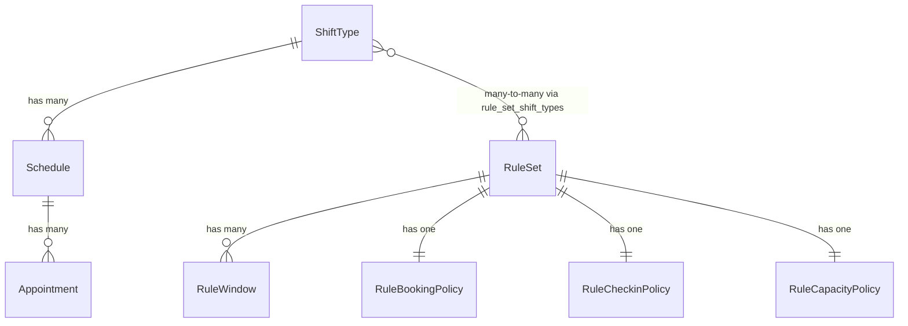
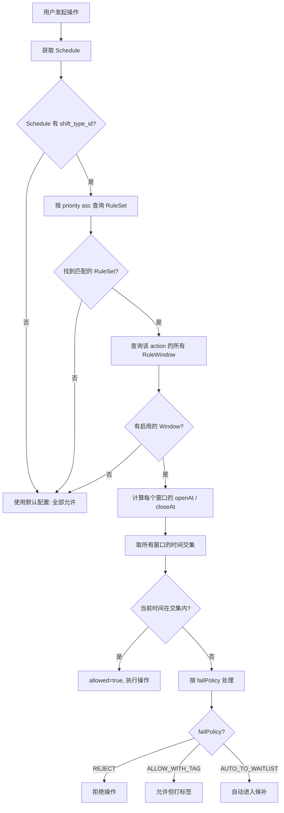

# 规则组与排班系统关系说明

## 1 概述

本文档说明规则组（RuleSet）与排班系统（Schedule / ShiftType）之间的数据关联关系，以及规则引擎在运行时如何选择并应用规则组。

---

## 2 核心数据模型

### 2.1 关键实体

| 实体 | 表名 | 说明 |
|------|------|------|
| 班次类型（ShiftType） | `shift_types` | 如门诊（OPD）、体检（CHECKUP）、急诊（EXAM）等 |
| 规则组（RuleSet） | `rule_sets` | 一组完整的预约/签到/取消规则集合 |
| 规则组-班次类型关联 | `rule_set_shift_types` | 多对多中间表 |
| 排班（Schedule） | `schedules` | 具体某天的某个班次，关联医生和班次类型 |
| 时间窗（RuleWindow） | `rule_windows` | 属于某个规则组，定义某动作的时间区间 |
| 各类策略 | `rule_booking_policies` / `rule_checkin_policies` / `rule_capacity_policies` | 属于某个规则组 |

### 2.2 关系总览

```
ShiftType 1---N RuleSetShiftType N---1 RuleSet
     |                                     |
     |  (中间表实现多对多)                  |---1 RuleBookingPolicy
     |                                     |---1 RuleCheckinPolicy
     |                                     |---1 RuleCapacityPolicy
     |                                     |---N RuleWindow
     |
     +---N Schedule (排班通过 shift_type_id 关联班次类型)
```

---

## 3 规则组与班次类型的关系：多对多

### 3.1 关联方式

通过中间表 `rule_set_shift_types` 实现：

```python
# rule_set.py 中的定义
class ShiftType(Base, AuditMixin):
    rule_sets = relationship("RuleSet", secondary="rule_set_shift_types", back_populates="shift_types")

class RuleSet(Base, AuditMixin):
    shift_types = relationship("ShiftType", secondary="rule_set_shift_types", back_populates="rule_sets")
```

### 3.2 业务含义

- 一个班次类型可以关联多个规则组（但运行时只取优先级最高的那个）
- 一个规则组可以适用于多个班次类型（如同一套规则同时适用于门诊和护理）

### 3.3 典型配置示例

| 规则组 | 适用的班次类型 |
|--------|----------------|
| 标准门诊规则 | OPD（门诊） |
| 专家门诊规则 | SPECIAL（特需） |
| 体检预约规则 | CHECKUP（体检） |
| 急诊规则 | EXAM（急诊） |

---

## 4 规则组与排班（Schedule）的关系：通过班次类型间接关联

### 4.1 间接关联路径

排班表（`schedules`）本身不直接存储 `rule_set_id`，而是通过以下路径间接关联：

```
Schedule.shift_type_id --> ShiftType.id
    --> rule_set_shift_types.shift_type_id
        --> rule_set_shift_types.rule_set_id
            --> RuleSet.id
```

### 4.2 排班模型关键字段

```python
class Schedule(Base, AuditMixin):
    shift_type_id = Column(String(36), ForeignKey("shift_types.id"), nullable=True, comment="班次类型ID")
    start_time = Column(Time)          # 班次开始时间
    end_time = Column(Time)            # 班次结束时间
    start_at = Column(DateTime)        # 开始时间（带时区）
    end_at = Column(DateTime)          # 结束时间（带时区）
    schedule_date = Column(Date)       # 排班日期
    timezone = Column(String(50))      # 时区
```

### 4.3 设计理由

排班与规则组不直接关联，而是通过班次类型做中间层，原因如下：

1. **解耦**：排班只关心"什么类型的班"，规则引擎根据类型匹配规则
2. **复用**：同一班次类型下的所有排班自动继承相同规则，无需逐条维护
3. **灵活**：更换规则组只需修改类型关联，不影响已有排班数据

---

## 5 规则引擎如何选择适用规则组

### 5.1 选择逻辑

规则引擎通过 `get_applicable_rule_set()` 方法按以下步骤匹配：

```
1. 输入：shift_type_id（来自 Schedule.shift_type_id）
2. 查询：JOIN rule_sets + rule_set_shift_types + shift_types
3. 条件：RuleSet.enabled = True AND ShiftType.id = ? AND ShiftType.enabled = True
4. 排序：ORDER BY RuleSet.priority ASC
5. 取值：LIMIT 1（取优先级最高的第一个）
```

### 5.2 对应代码

```python
# time_windows.py
async def get_applicable_rule_set(self, shift_type_id: str) -> Optional[RuleSet]:
    result = await self.db.execute(
        select(RuleSet)
        .join(RuleSet.shift_types)
        .where(and_(
            RuleSet.enabled == True,
            ShiftType.id == shift_type_id,
            ShiftType.enabled == True,
        ))
        .order_by(RuleSet.priority.asc())
        .limit(1)
    )
    return result.scalar_one_or_none()
```

### 5.3 优先级规则

- `priority` 字段为整数，**值越小优先级越高**
- 当同一班次类型命中多个启用的规则组时，取 `priority` 最小的那个
- 如果没有匹配到任何规则组，返回默认结果（所有操作均允许，参见下文"默认行为"）

### 5.4 默认行为

当排班未关联班次类型，或没有匹配到规则组时：

```python
def _get_default_window_result(self, schedule, action, current_time):
    return {
        "allowed": True,
        "open_at": current_time,
        "close_at": current_time + timedelta(days=365),  # 1年有效期
        "fail_policy": "ALLOW",
        "message": "使用默认配置",
    }
```

即：不限制任何操作，所有动作在 365 天内均允许。

---

## 6 时间窗计算流程

### 6.1 完整计算步骤

```
用户发起操作（预约/签到/取消）
        |
        v
[1] 获取排班 Schedule 对象
        |
        v
[2] 从 Schedule 取 shift_type_id
        |
        v
[3] 按 priority  asc 匹配 RuleSet（上节逻辑）
        |
        v
[4] 从 RuleSet 取该 action 的所有 RuleWindow
    (可能有多个窗口，如签到可能有两个窗口限制)
        |
        v
[5] 对每个 Window 计算实际时间区间：
    referenceTime = _get_reference_time(schedule, window.reference_point)
    openAt  = referenceTime + window.open_offset_sec
    closeAt = referenceTime + window.close_offset_sec
        |
        v
[6] 判断当前时间是否在所有窗口的并集内
    - 所有窗口都满足 -> 允许
    - 任一窗口不满足 -> 按 failPolicy 处理
        |
        v
[7] 返回结果 { allowed, open_at, close_at, fail_policy, message }
```

### 6.2 参考点计算

`_get_reference_time()` 根据三种参考点计算基准时间：

| 参考点 | 取值来源 | 典型用途 |
|--------|----------|----------|
| `SHIFT_START` | `schedule.start_at` 或 `combine(schedule_date, start_time)` | 预约开放/截止、签到开放 |
| `SHIFT_END` | `schedule.end_at` 或 `combine(schedule_date, end_time)` | 签到截止（必须在下班前） |
| `BOOKING_CREATED_AT` | 预约记录的创建时间 | 签到最早时间（如预约后30分钟才能签到） |

### 6.3 偏移量说明

- `open_offset_sec` / `close_offset_sec` 可为正、负或 `null`
- **负值**：在参考点之前（如 -604800 = 提前7天开放）
- **正值**：在参考点之后（如 +3600 = 开始后1小时截止）
- **null**：表示该方向不限制

| 偏移量（秒） | 含义 |
|-------------|------|
| -604800 | 提前 7 天 |
| -259200 | 提前 3 天 |
| -86400 | 提前 1 天 |
| -14400 | 提前 4 小时 |
| -7200 | 提前 2 小时 |
| -3600 | 提前 1 小时 |
| -1800 | 提前 30 分钟 |
| 0 | 参考点时刻 |
| +900 | 延后 15 分钟 |
| +1800 | 延后 30 分钟 |
| +3600 | 延后 1 小时 |

### 6.4 多窗口交叉判断

同一 action 可以配置多个 RuleWindow，引擎取**所有窗口的交集**：

- `combined_open_at = max(所有窗口的 open_at)`
- `combined_close_at = min(所有窗口的 close_at)`
- 当前时间必须同时满足所有窗口才算在有效期内

### 6.5 边界包含判断

```python
def _is_in_window(self, current_time, open_at, close_at, open_inclusive, close_inclusive):
    # open_inclusive=True  : current_time >= open_at
    # open_inclusive=False : current_time > open_at
    # close_inclusive=True : current_time <= close_at
    # close_inclusive=False: current_time < close_at
```

每个 Window 的 `open_inclusive` / `close_inclusive` 如果为 `null`，则继承 RuleSet 的 `default_open_inclusive` / `default_close_inclusive`。

---

## 7 数据流总览图

### 7.1 数据关系图（Mermaid）



### 7.2 规则匹配流程图（Mermaid）



### 7.3 时间窗计算示意图（ASCII）

```
时间轴（以 SHIFT_START 为参考点的预约时间窗为例）：

  openOffset=-7d              closeOffset=0       SHIFT_START
       |                           |                   |
       v                           v                   v
  ------|==========================|-------------------|------> 时间
        ^                          ^                   ^
        |                          |                   |
   开放预约                   截止预约              班次开始

  其中:
  - 开放区间 [openAt, closeAt)
  - openAt  = SHIFT_START + (-7天) = 班次开始前7天
  - closeAt = SHIFT_START + 0     = 班次开始时刻
  - openInclusive=true  : 含开放边界
  - closeInclusive=false: 不含截止边界（班次开始时刻不能预约）
```

### 7.4 多窗口交叉示例（ASCII）

以默认配置中的签到为例，配置了两个签到窗口：

```
窗口1: reference=BOOKING_CREATED_AT, open=+30min, close=null
窗口2: reference=SHIFT_END,          open=null,   close=0

实际生效区间 = 窗口1 AND 窗口2 的交集

时间轴:
                    BOOKING_CREATED                    SHIFT_END
                         |                                 |
  -------+-----|=========|=================================|=====|----> 时间
         ^     ^         ^                                 ^
         |     |         |                                 |
      窗口2开始  窗口1开始  预约创建时刻                    班次结束时刻

  生效签到区间:
  - 最早: 预约后30分钟（窗口1限制）
  - 最晚: 班次结束时刻（窗口2限制）
  - 即 [预约后30min, 班次结束时刻]
```

---

## 8 策略层执行顺序

时间窗判断通过后，规则引擎继续执行策略层的校验。完整校验链路如下：

```
[预约操作 BOOK]
  1. 时间窗校验（check_action_window）
  2. 预约冲突校验（check_booking_conflicts）
     - 同班次限制
     - 每日/每周配额
     - 时间重叠检测
     - 同类型同日限制
  3. 容量校验（check_capacity_limits）
     - 总容量检查（含超额）
     - 用户容量检查
     - 候补队列处理

[签到操作 CHECKIN]
  1. 时间窗校验
  2. 签到前置条件（requireBooking, maxTimes）
  3. 宽限期计算（calculate_checkin_grace_period）

[取消操作 CANCEL]
  1. 时间窗校验
```

---

## 9 附录：代码文件索引

| 文件 | 职责 |
|------|------|
| `app/models/rule_set.py` | 数据模型定义（RuleSet, ShiftType, RuleWindow, 各 Policy） |
| `app/models/schedule.py` | 排班模型，通过 `shift_type_id` 关联班次类型 |
| `app/modules/rule_engine/service.py` | 规则引擎门面类，组合各 Mixin |
| `app/modules/rule_engine/time_windows.py` | 规则匹配 + 时间窗计算核心逻辑 |
| `app/modules/rule_engine/policies.py` | 各策略查询（预约/签到/容量） |
| `app/modules/rule_engine/validation.py` | 冲突检测、容量检查、宽限期计算 |
